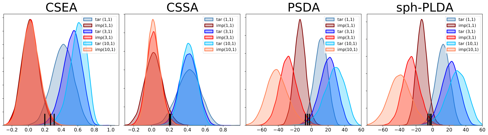

<div align="center">
  <h1>Probabilistic Back-ends for Online Speaker Recognition and Clustering</h1>

  <a href="https://ieeexplore.ieee.org/document/10097032"></a>
  <a href="https://arxiv.org/abs/2302.09523"></a>
  <a href="LICENSE.txt"></a>

  <b>Alexey Sholokhov<sup>1*</sup>, Nikita Kuzmin<sup>2,3*</sup>, Kong Aik Lee<sup>3</sup>, Eng Siong Chng<sup>2</sup></b>
  <br>
  <sup>1</sup>Federal Research Center "Computer Science and Control" of the Russian Academy of Sciences, Moscow, Russia
  <br>
  <sup>2</sup><a href="https://www.ntu.edu.sg/">Nanyang Technological University</a>, Singapore
  <br>
  <sup>3</sup><a href="https://www.a-star.edu.sg/i2r">Institute for Infocomm Research, A*STAR</a>, Singapore
  <br>
  <i>* Equal contribution</i>
  <h4>ICASSP 2023</h4>
</div>

---

## Table of Contents

- [Spherical PLDA](#spherical-plda)
- [Results](#results)
- [Installation](#installation)
- [Usage](#usage)
- [Citation](#citation)
- [License & Acknowledgments](#license--acknowledgments)

---

## Spherical PLDA

This is a PyTorch implementation of a simple probabilistic scoring backend suitable for speaker recognition or clustering.

*Spherical* PLDA (sph-PLDA) is a special case of probabilistic linear discriminant analysis (PLDA) applied to length-normalized embeddings. Unlike the general model, sph-PLDA is parameterized by only two scalars that can be easily learned from data.

This model is presented as a possible replacement for cosine similarity, a popular scoring backend for large-margin embeddings. It can be shown that for length-normalized and centered embeddings, the verification log likelihood ratio of the sph-PLDA can be written as a scaled and shifted cosine similarity measure. That is, sph-PLDA is *equivalent* to cosine scoring for one-to-one comparisons. However, as revealed in our experiments, sph-PLDA outperforms cosine scoring in multi-enrollment verification.

Another closely related scoring backend is the so-called probabilistic spherical discriminant analysis (PSDA) proposed [here](https://arxiv.org/abs/2203.14893). It can be viewed as a PLDA model with Gaussian distributions replaced by von Mises-Fisher (VMF) distributions that are defined on the unit hypersphere. The relation to spherical PLDA follows from the fact that restricting any isotropic Gaussian density to the unit hypersphere gives a VMF density, up to normalization. However, the two models are *not* equivalent, though their behavior is very similar, thus, sph-PLDA can serve as a more numerically stable alternative.

---

## Results

### Multi-enrollment verification

Distributions of target and impostor scores for different numbers of enrollment segments: 1, 3 and 10. Here and below, the notation (#enrollments, #tests) represents the number of enrollment or test segments in a single trial. Short black vertical lines represent EER thresholds.

Four different scoring backends are compared:
* CSEA - cosine similarity w/ embeddings averaging
* CSSA - cosine similarity w/ scores averaging
* sph-PLDA - spherical PLDA, by-the-book scoring
* PSDA - probabilistic spherical discriminant analysis, by-the-book scoring

<p align="center">
  
</p>

Results for multi-enrollment speaker verification with the embeddings extractor from [SpeechBrain](https://huggingface.co/speechbrain/spkrec-ecapa-voxceleb). Equal error rates (EER, %) with minDCF ($P_\text{target}=0.01$) in the last column (lower is better).

|  Scoring | (1, 1) | (3, 1) | (10, 1) | (3, 3) |    pooled    |
|:--------:|:------:|:------:|:-------:|:------:|:------------:|
| CSEA     |  4.98  |  1.65  |   0.83  |  0.17  | 2.85 / 0.206 |
| CSSA     |  4.98  |  1.79  |   1.02  |  0.37  | 2.05 / 0.228 |
| sph-PLDA |  4.98  |  1.60  |   0.78  |  0.14  | 1.99 / 0.170 |
| PSDA     |  4.85  |  1.55  |   0.78  |  0.13  | 2.08 / 0.172 |

PLDA and PSDA have comparable performance and outperform cosine based scoring methods. See [RESULTS.md](RESULTS.md) for full tables across all 3 extractors (CLOVA, SpeechBrain, BUT).

### Online speaker diarization

See [RESULTS.md](RESULTS.md) for the details.

---

## Installation

1. Install required packages:
   ```bash
   pip install -r requirements.txt
   ```

2. Set up environment paths (run each new terminal session):
   ```bash
   source ./path.sh
   ```

3. Download pretrained models:
   ```bash
   bash download.sh
   ```

---

## Usage

<details>
<summary><b>Quick start</b> — speaker verification reproduction (steps 1–7)</summary>

1. Put all relevant dataset paths in [config_common.yaml](config_common.yaml). Used only for embedding extraction.

2. Install required packages:
   ```bash
   pip install -r requirements.txt
   ```

3. Set up environment and download models:
   ```bash
   source ./path.sh
   bash download.sh
   ```

4. Extract embeddings from audio recordings (or download pre-computed embeddings from [RESULTS.md#data](RESULTS.md#data)):
   ```bash
   python exp/extract_embeddigs_from_datasets.py --emb XXX
   ```

5. Verify embeddings were extracted correctly:
   ```bash
   python exp/verification/test_embeddings_voxceleb.py
   ```

6. Train sph-PLDA and PSDA models:
   ```bash
   python exp/train_backend.py
   ```

7. Reproduce multi-enrollment speaker verification experiment:
   ```bash
   python exp/verification/multienroll_verification.py
   ```

</details>

<details>
<summary><b>Full diarization reproduction</b> — hyperparameter search + evaluation</summary>

1. Search for clustering algorithm hyperparameters on the dev split:
   ```bash
   bash optimize_hyperparams_diarization_skopt.sh
   ```
   Then set the resulting hyperparameters in `exp/diarization/parameters_*.py`.

2. Run diarization evaluation:
   ```bash
   bash eval_diarization.sh
   ```
   Or run a single configuration directly:
   ```bash
   python exp/diarization/run_diarization.py --emb XXX --alg YYY --data AMI_test --win 2.0 --hop 1.0
   ```

</details>

---

## Citation

If you find the code useful, please cite the following paper:

```
@article{sholokhov2023backends,
  title={Probabilistic back-ends for online speaker recognition and clustering},
  author={Alexey Sholokhov and Nikita Kuzmin and Kong Aik Lee and Eng Siong Chng},
  journal={arXiv:2302.09523},
  year={2023}
}
```
---

## License & Acknowledgments

This project is licensed under the [MIT License](LICENSE.txt).

Parts of the code were borrowed from the [VBx](https://github.com/BUTSpeechFIT/VBx) repository. The authors also thank [@yinruiqing](https://github.com/yinruiqing) for helpful discussions on speaker diarization.
